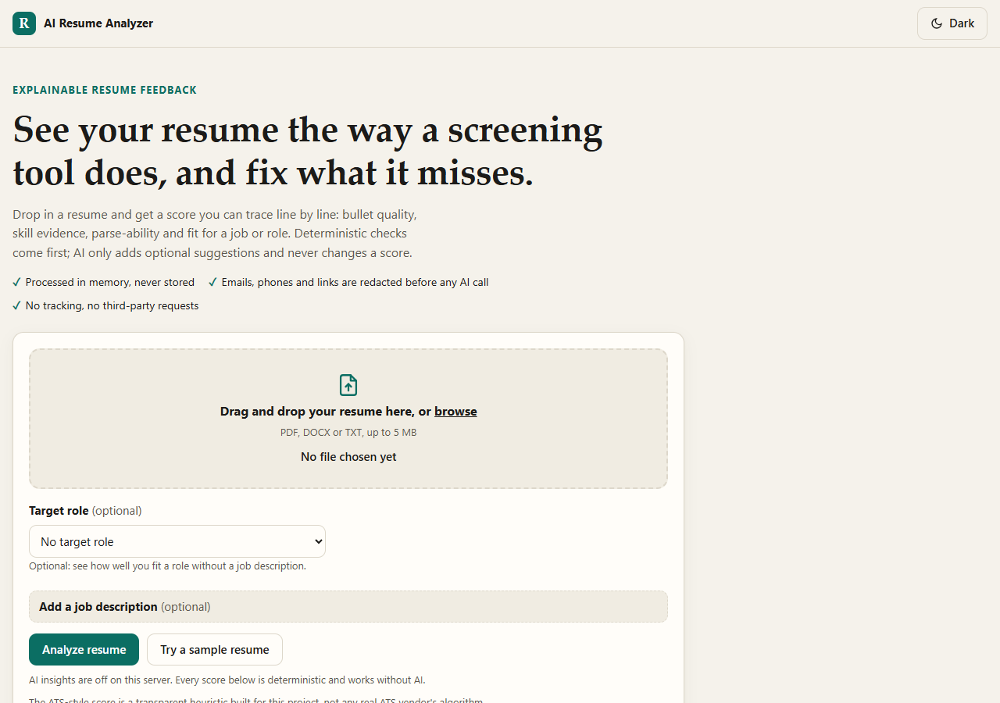
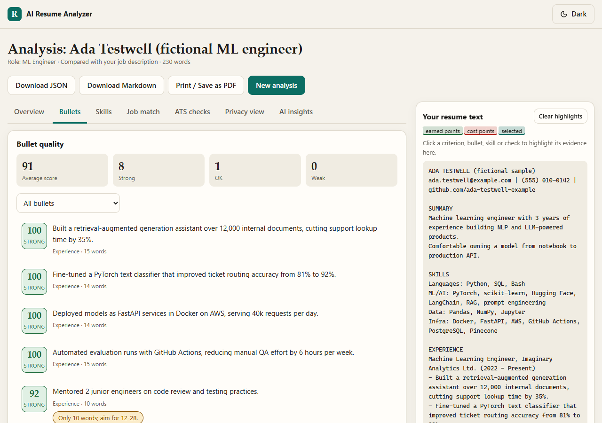
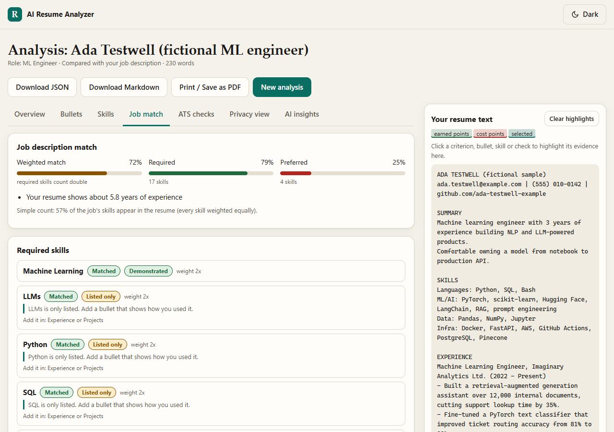
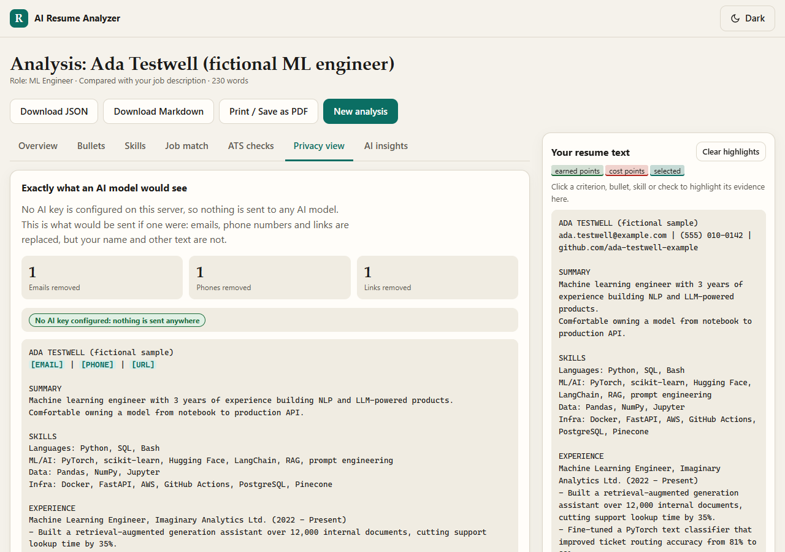
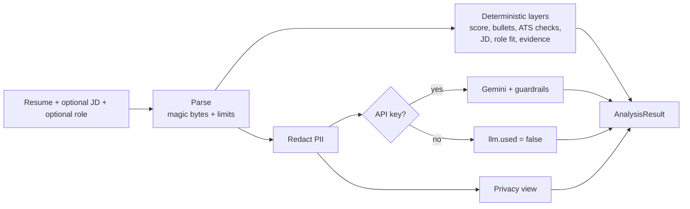

# AI Resume Analyzer

**Upload a resume (or press "Try a sample resume") and get an explainable ATS-style score, a bullet-by-bullet critique, parse-ability checks and a job-description match, all computed by transparent rules. An optional LLM adds guarded extras, sees only redacted text, and never changes a score.**


**Try a sample resume:** open the app and press **Try a sample resume**. No upload, no account, no API key. The sample is fictional.

Live demo: [TODO]

## The problem

Job seekers get a single number from "resume checkers" with no explanation, and many AI tools
send their full resume, including phone number and email, straight to an LLM. This project
does the opposite: every score is deterministic and explained with the exact lines that earned
or lost points, and the optional LLM only sees redacted text, which you can inspect yourself.

## Screenshots

Fictional sample resume and sample ML-engineer job description, no API key set.

**Home**



**Overview**: ATS-style score, composite readiness, radar chart and the resume text with highlights


**Bullets**: every experience bullet scored, with issues and a template hint



**Job match**: required and preferred skills, role fit, skills to learn next



**Privacy view**: the exact redacted text an AI model would receive



## Features

- **Upload PDF, DOCX or TXT** by drag and drop (type detected from file content, not the extension), or use the sample button.
- **Explainable ATS-style score (0-100)** with a reason and evidence for every criterion.
  *A transparent heuristic written for this project, not any real ATS vendor's algorithm.*
- **Evidence highlighting**: a resume viewer highlights the lines that earned or lost points; click a criterion, bullet, skill or check to jump to them.
- **Bullet analyzer**: each experience/project bullet scored 0-100 on action verb, measurable result, length, weak phrases, buzzwords, first person and tense, with a template hint (never invented numbers).
- **ATS parse-ability checks**: pass/warn/fail checklist for contact info, section headings, date formats, special glyphs, column artifacts, long lines and length.
- **Job-description intelligence**: required vs preferred skills (required weighs 2x), "X or Y" alternatives, years-of-experience asks, a seniority cue and "where to add it" hints.
- **Role fit**: pick one of 8 target roles (no JD needed) to get a role-fit % and a ranked "skills to learn next" list.
- **Skill evidence**: skills grouped by category and marked as demonstrated in a bullet or only listed.
- **Tone and readability**: passive-voice rate, buzzword density and repeated opening verbs with alternatives.
- **Composite readiness**: one headline number combining ATS score, bullet quality, parse-ability and fit, with the weights shown. It sits beside the ATS-style score and does not replace it.
- **Privacy view**: shows the exact redacted text an AI model would receive, with redaction counts. Works without a key.
- **AI insights (optional, Gemini)**: profile summary, suggestions, interview questions, tailored rewrites of up to 3 weakest bullets and a short recruiter's first impression, all behind guardrails.
- **Product UI**: animated gauge, radar chart in inline SVG, tabs, light/dark theme with a toggle, responsive layout, keyboard accessible, no external requests.
- **Export**: download JSON or Markdown, or print / save as PDF.
- Works fully **without an API key**. Web page, JSON API and command-line interface.

## Tech stack

Python 3.12 · FastAPI · Pydantic v2 · pydantic-settings · pypdf · python-docx ·
google-genai (Gemini) · vanilla JS + CSS (no build step) · pytest · ruff · Docker · GitHub Actions

## How it works



Layer map, guardrail table and design decisions: [docs/ARCHITECTURE.md](docs/ARCHITECTURE.md).

## Engineering highlights

- **Deterministic first, LLM second.** Every score, check and match works with no key and never depends on the LLM.
- **LLM guardrails**, each covered by offline tests (full table in [docs/ARCHITECTURE.md](docs/ARCHITECTURE.md)): PII redaction before the prompt, prompt-injection delimiters, schema validation with retries and fallback, skill grounding, bounds, rewrites that may not add numbers or skills (a best-effort check), no resume text in logs, and input limits (5 MB, 10 PDF pages, 50k characters, 20k-character JD, ZIP-bomb protection).
- **Public-deploy hardening**: per-IP in-memory rate limit (default 20 analyses per 10 minutes), security headers including a strict CSP, CORS off by default, nothing stored, and a cap on skill mentions per document.
- **XSS-safe UI**: user text is inserted with `textContent` only; a test fails if any script uses `innerHTML`.
- **Tests**: the suite runs offline with a fake LLM; PDF and DOCX fixtures are generated at test time.
- **Evaluation**: `scripts/run_eval.py` measures skill-extraction precision, recall and F1 on hand-labelled synthetic resumes and checks that the v2 layers score the weak and messy samples clearly below the strong ones.
- **CI**: GitHub Actions runs `ruff check`, `ruff format --check`, `pytest` and the eval (fails if overall F1 is below 0.90).

## Getting started

Requires Python 3.12.

**Windows (PowerShell)**

```powershell
git clone https://github.com/khushijaiswal08/AI-Resume-Analyzer.git
cd AI-Resume-Analyzer
py -3.12 -m venv .venv
.venv\Scripts\Activate.ps1
pip install -e ".[dev]"
copy .env.example .env   # optional: add your own GEMINI_API_KEY to enable AI insights
resume-analyzer serve    # open http://127.0.0.1:8000
```

**macOS / Linux**

```bash
git clone https://github.com/khushijaiswal08/AI-Resume-Analyzer.git
cd AI-Resume-Analyzer
python3.12 -m venv .venv
source .venv/bin/activate
pip install -e ".[dev]"
cp .env.example .env     # optional: add your own GEMINI_API_KEY to enable AI insights
resume-analyzer serve    # open http://127.0.0.1:8000
```

`.env` is git-ignored. Without a key everything except AI insights works.

**Docker** (the Dockerfile has not been built or run in the environment where v2 was written)

```bash
docker build -t resume-analyzer .
docker run -p 8000:8000 resume-analyzer
# with AI insights: docker run -p 8000:8000 -e GEMINI_API_KEY=your-key resume-analyzer
```

Deploying to Render: see [DEPLOY.md](DEPLOY.md).

**Command line**

```bash
resume-analyzer analyze evals/samples/ada_testwell_ml.txt --jd evals/samples/ml_engineer.jd.txt
resume-analyzer analyze my_resume.pdf --format json --no-llm
```

## Run tests

```bash
ruff check .
ruff format --check .
pytest
```

The test suite needs no network access and no API key.

## Run the evaluation

```bash
python scripts/run_eval.py                # skill precision / recall / F1 + v2 layer sanity table
python scripts/run_eval.py --details      # also lists missed and extra skills
python scripts/run_eval.py --min-f1 0.90  # exit code 1 if overall F1 < 0.90 (used in CI)
```

Run it to see current numbers. Output of one run of this version (4 labelled synthetic samples in
`evals/samples`, plus a weak and a messy sample in `evals/quality_samples`; fictional people):

```
OVERALL (micro)                     78   1   4       0.99    0.95   0.97

v2 layers (no LLM)
sample                              ATS  bullets  parse   JD%  ready  checks
ada_testwell_ml.txt                  92       91     95    72     88  ok
bruno_placeholder_frontend.txt       91       87     95    88     90  ok
carla_sampleton_data.txt             90       94     95    83     91  ok
dev_fakename_devops.txt              92       90     95     -     92  ok
weak_pat_generic.txt                 33       29     85     -     45  ok
messy_sam_layout.txt                 34        -     64     -     45  ok
```

(Skill columns: TP, FP, FN, precision, recall, F1.) A few small samples written by the author are
not a benchmark. They are a regression check.

## API

| Endpoint | Purpose |
|---|---|
| `POST /api/analyze` | multipart: `resume` (PDF/DOCX/TXT), optional `job_description`, optional `role` (id from `/api/roles`) |
| `GET /api/roles` | the 8 target roles |
| `GET /api/sample` | fictional sample resume and JD for the "Try a sample" button |
| `GET /api/health` | `{"status": "ok", "llm_configured": false, "version": "2.0.0"}` |
| `GET /openapi.json` | OpenAPI schema (the interactive `/docs` page is disabled: it loads scripts from a CDN, which the CSP forbids) |
| `GET /` | the web page |

```bash
curl -X POST http://127.0.0.1:8000/api/analyze \
  -F "resume=@evals/samples/bruno_placeholder_frontend.txt" \
  -F "job_description=<evals/samples/frontend_developer.jd.txt" \
  -F "role=frontend"
```

The v1 fields (`skills`, `sections`, `word_count`, `ats_score`, `jd_match`, `llm`, `redaction`,
`warnings`) are unchanged. v2 adds `bullets`, `ats_checks`, `jd_analysis`, `role_fit`,
`readability`, `skill_evidence`, `evidence`, `readiness`, `redacted_preview` and `resume_text`.
All character offsets index into `resume_text`.

Errors return JSON `{"detail": "..."}`: 413 file or JD too large, 415 unsupported file type,
422 unreadable file or unknown role, 429 rate limit (with a `Retry-After` header).

Configuration (environment variables, all optional): `GEMINI_API_KEY`, `GEMINI_MODEL`,
`MAX_UPLOAD_MB`, `PORT`, `RATE_LIMIT_MAX`, `RATE_LIMIT_WINDOW_SECONDS`, `TRUST_PROXY`,
`CORS_ORIGINS`. See [.env.example](.env.example).

## Project structure

```
src/resume_analyzer/
  api.py             FastAPI app, security headers, rate limit
  service.py         pipeline orchestration + LLM guardrails
  parsing.py         bytes -> text, magic-byte detection, limits
  redaction.py       email / phone / URL redaction
  sections.py        section headings and line offsets
  skills.py          taxonomy matching with offsets (data/skills.json)
  scoring.py         the explained ATS-style score
  bullets.py         L1 bullet analyzer
  ats_checks.py      L2 parse-ability checks
  jd.py              L3 job-description intelligence
  roles.py           L4 role fit (data/roles.json)
  evidence.py        L5 evidence and offsets
  readability.py     L6 tone and readability
  skill_evidence.py  L7 demonstrated vs listed skills
  privacy.py         L8 privacy view
  rewrites.py        L9 LLM rewrite guardrails
  readiness.py       L10 composite readiness
  llm/               LLMClient protocol, Gemini client, fake client, prompts, guards
  static/            UI (vanilla JS + CSS, no build step)
tests/               pytest suite (offline)
evals/               synthetic resumes, JDs and expected labels
scripts/run_eval.py
docs/                SPEC, SPEC_V2, ARCHITECTURE, screenshots
DEPLOY.md, render.yaml
```

## Limitations

- Skills are found only if they are in the taxonomy (about 170 skills); new or niche tools are missed.
- Section detection relies on recognisable headings; unusual layouts may not be detected.
- Scanned (image-only) PDFs are not supported; there is no OCR.
- Multi-column PDFs can extract in a mixed order, which affects line-based criteria.
- The scores are transparent heuristics, not a prediction of how any real ATS will rank a resume.
- JD parsing is rule-based: unusual wording can be read as required when it is preferred, or the reverse.
- The number check on AI rewrites is best-effort, and rewrites are always shown next to the original.
- The rate limit is per process and in memory; it resets on restart.
- English resumes only.
- The evaluation set is small and synthetic.

## License

MIT, see [LICENSE](LICENSE).

Author: **Khushi Jaiswal**
