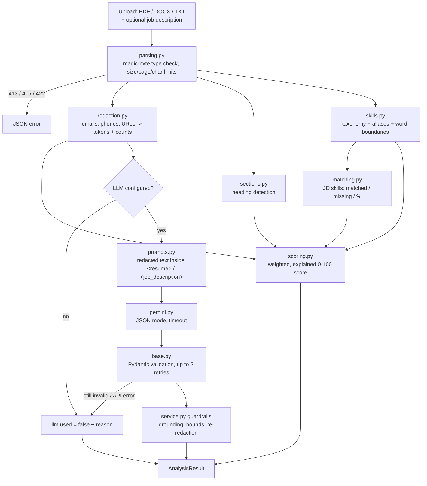

# Architecture

## Pipeline

`service.py` orchestrates the steps. `api.py` (FastAPI) and `cli.py` are thin wrappers around it,
so the web app, the CLI and the tests all exercise the same code path.

## Guardrails

| # | Guardrail | Where | Test |
|---|---|---|---|
| 1 | PII (emails, phones, URLs) redacted before any prompt is built | `redaction.py`, `service.analyze_text` | `test_llm_never_sees_contact_details` |
| 2 | Prompt-injection defence: untrusted text wrapped in `<resume>` / `<job_description>`; system instruction says it is data; delimiter tags inside the text are neutralised | `llm/prompts.py` | `test_untrusted_text_is_wrapped_in_delimiters`, `test_resume_cannot_close_its_own_delimiter`, `test_injection_cannot_change_the_score` |
| 3 | Structured output: response must validate against `LLMInsights`; invalid JSON or schema errors are retried up to 2 times, then the LLM step falls back | `llm/base.generate_with_retries` | `test_invalid_json_is_retried_then_succeeds`, `test_gives_up_after_two_retries_and_falls_back` |
| 4 | Grounding: each interview question's skill tag, and every technical skill the extractor finds in the summary, suggestions and question text, must be a deterministically extracted resume skill or a JD skill; ungrounded questions and suggestions are dropped and summary sentences removed, with a warning (soft skills are not checked) | `service.apply_guardrails`, `service._ungrounded_skills` | `test_ungrounded_questions_are_dropped_with_warning`, `test_ungrounded_skill_in_summary_sentence_is_removed`, `test_ungrounded_skill_in_suggestion_is_dropped`, `test_question_tagged_with_grounded_skill_but_asking_about_another_is_dropped` |
| 5 | Bounds: at most 8 suggestions, 10 questions, 300 characters per string | `service.apply_guardrails` | `test_lists_and_strings_are_bounded` |
| 6 | The LLM never changes the score: it runs after scoring and its schema has no score field | `service.analyze_text` | `test_score_identical_with_and_without_llm` |
| 7 | Graceful degradation: no key, timeout, API error or client bug gives `llm.used=false` with a reason; the response is still 200 | `service.run_llm` | `test_llm_errors_degrade_gracefully`, `test_llm_failure_does_not_break_api` |
| 8 | No resume text in logs; only sizes, counts and timings | `service.analyze_document`, `llm/gemini.py`, `llm/base.py` | `test_logs_contain_no_resume_text` |
| 9 | Input limits: 5 MB upload, 10 PDF pages, 50k extracted characters (truncated with a warning), 20k-character JD; a DOCX whose declared uncompressed size exceeds 50 MB (or 10 MB for `word/document.xml`) is rejected with 413 before it is unpacked | `parsing.py`, `api.py`, `service._validate_jd` | `test_parsing.py` (incl. `test_docx_zip_bomb_is_rejected_before_parsing`), `test_too_long_jd_is_413` |

LLM output is also passed through the redactor again before it is returned, in case the model
invents contact details.

## Design decisions

- **Deterministic first, LLM second.** Skills, sections, JD match and the score work with no
  API key, cost nothing and give the same answer every time. The LLM only adds text that is
  hard to produce with rules (summary, suggestions, interview questions).
- **Taxonomy instead of LLM skill extraction.** A curated list (`data/skills.json`) is
  explainable and testable, and the eval script can measure it. The trade-off is that skills
  missing from the list are not found; the eval output shows these misses.
- **Word boundaries with custom rules.** `+`, `#` and `&` count as part of a word so "C" never
  matches inside "C++" and "R" never matches "R&D". Short, ambiguous words (Go, R, React, Excel)
  only match with exact capitalisation, and not at the start of phrases like "Go-to-market" or
  "R-squared". When names overlap, the longest match wins, so "GitHub Actions" does not also
  count as "GitHub". Emails and URLs are removed before matching, so a profile link such as
  `github.com/someone/docker-tools` does not count as a Docker skill.
- **Integer weights that always sum to 100.** Without a JD, the JD weight is redistributed
  proportionally using the largest-remainder method, so rounding never produces 99 or 101.
- **File type from magic bytes.** The file name is user input and can lie; the first bytes of the
  file cannot.
- **One `LLMClient` protocol.** `GeminiClient` and `FakeLLM` share the same retry/validation
  loop, so the tests exercise the real guardrail code without network access.
- **No database, no storage.** Uploads are processed in memory and discarded, which removes a
  whole class of privacy questions.
- **The score is a heuristic.** It is not the algorithm of any real applicant tracking system.
