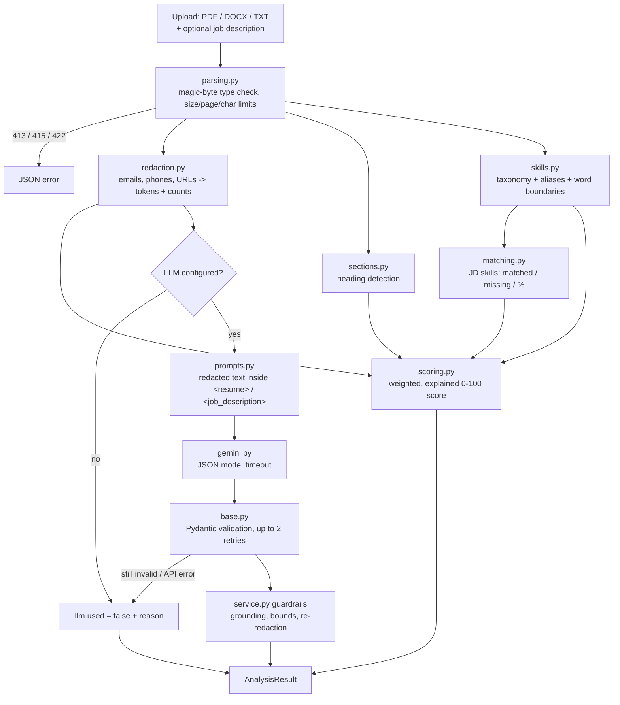
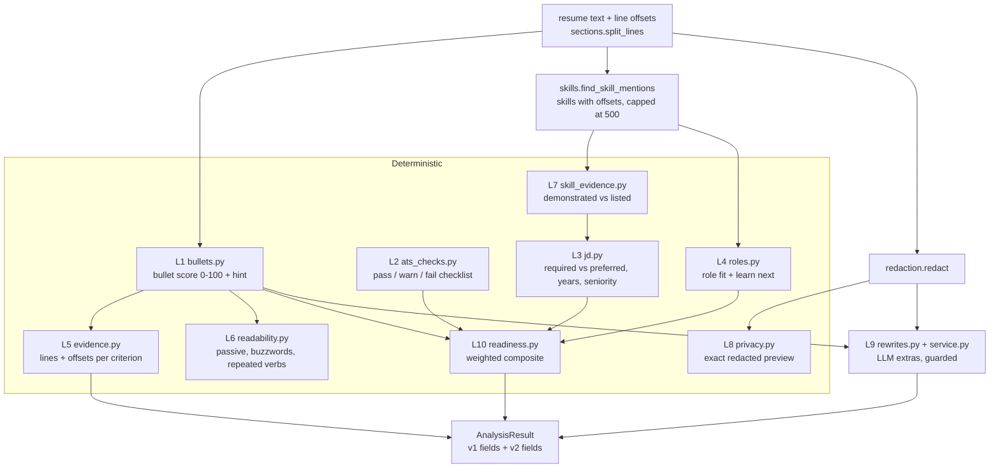

# Architecture

## Pipeline

`service.py` orchestrates the steps. `api.py` (FastAPI) and `cli.py` are thin wrappers around it,
so the web app, the CLI and the tests all exercise the same code path.

## Guardrails

| # | Guardrail | Where | Test |
|---|---|---|---|
| 1 | Contact details (emails, phone numbers incl. Indian formats, URLs) redacted before any prompt is built; names and other text are not removed | `redaction.py`, `service.analyze_text` | `test_llm_never_sees_contact_details` |
| 2 | Prompt-injection defence: untrusted text wrapped in `<resume>` / `<job_description>`; system instruction says it is data; delimiter tags inside the text are neutralised | `llm/prompts.py` | `test_untrusted_text_is_wrapped_in_delimiters`, `test_resume_cannot_close_its_own_delimiter`, `test_injection_cannot_change_the_score` |
| 3 | Structured output: response must validate against `LLMInsights`; invalid JSON or schema errors are retried up to 2 times, then the LLM step falls back | `llm/base.generate_with_retries` | `test_invalid_json_is_retried_then_succeeds`, `test_gives_up_after_two_retries_and_falls_back` |
| 4 | Grounding: each interview question's skill tag, and every technical skill the extractor finds in the summary, suggestions and question text, must be a deterministically extracted resume skill or a JD skill; ungrounded questions and suggestions are dropped and summary sentences removed, with a warning (soft skills are not checked) | `service.apply_guardrails`, `service._ungrounded_skills` | `test_ungrounded_questions_are_dropped_with_warning`, `test_ungrounded_skill_in_summary_sentence_is_removed`, `test_ungrounded_skill_in_suggestion_is_dropped`, `test_question_tagged_with_grounded_skill_but_asking_about_another_is_dropped` |
| 5 | Bounds: at most 8 suggestions, 10 questions, 300 characters per string | `service.apply_guardrails` | `test_lists_and_strings_are_bounded` |
| 6 | The LLM never changes the score: it runs after scoring and its schema has no score field | `service.analyze_text` | `test_score_identical_with_and_without_llm` |
| 7 | Graceful degradation: no key, timeout, API error or client bug gives `llm.used=false` with a reason; the response is still 200 | `service.run_llm` | `test_llm_errors_degrade_gracefully`, `test_llm_failure_does_not_break_api` |
| 8 | No resume text in logs; only sizes, counts and timings | `service.analyze_document`, `llm/gemini.py`, `llm/base.py` | `test_logs_contain_no_resume_text` |
| 9 | Input limits: 5 MB upload, 10 PDF pages, 50k extracted characters (truncated with a warning), 20k-character JD; a DOCX whose declared uncompressed size exceeds 50 MB (or 10 MB for `word/document.xml`) is rejected with 413 before it is unpacked | `parsing.py`, `api.py`, `service._validate_jd` | `test_parsing.py` (incl. `test_docx_zip_bomb_is_rejected_before_parsing`), `test_too_long_jd_is_413` |

LLM output is also passed through the redactor again before it is returned, in case the model
invents contact details.

## Design decisions

- **Deterministic first, LLM second.** Skills, sections, JD match and the score work with no
  API key, cost nothing and give the same answer every time. The LLM only adds text that is
  hard to produce with rules (summary, suggestions, interview questions).
- **Taxonomy instead of LLM skill extraction.** A curated list (`data/skills.json`) is
  explainable and testable, and the eval script can measure it. The trade-off is that skills
  missing from the list are not found; the eval output shows these misses.
- **Word boundaries with custom rules.** `+`, `#` and `&` count as part of a word so "C" never
  matches inside "C++" and "R" never matches "R&D". Short, ambiguous words (Go, R, React, Excel)
  only match with exact capitalisation, and not at the start of phrases like "Go-to-market" or
  "R-squared". When names overlap, the longest match wins, so "GitHub Actions" does not also
  count as "GitHub". Emails and URLs are removed before matching, so a profile link such as
  `github.com/someone/docker-tools` does not count as a Docker skill.
- **Integer weights that always sum to 100.** Without a JD, the JD weight is redistributed
  proportionally using the largest-remainder method, so rounding never produces 99 or 101.
- **File type from magic bytes.** The file name is user input and can lie; the first bytes of the
  file cannot.
- **One `LLMClient` protocol.** `GeminiClient` and `FakeLLM` share the same retry/validation
  loop, so the tests exercise the real guardrail code without network access.
- **No database, no storage.** Uploads are processed in memory and discarded, which removes a
  whole class of privacy questions.
- **The score is a heuristic.** It is not the algorithm of any real applicant tracking system.

# v2 additions

The v1 pipeline above is unchanged. v2 adds ten deterministic or guarded layers around it. The
principle is the same: **rules first, LLM second, and the LLM never changes a score.** All
layers are pure functions in their own module with their own tests.

## v2 layers

| Layer | Module | What it adds |
|---|---|---|
| L1 | `bullets.py` | per-bullet score on action verb, metric, length, weak phrases, buzzwords, pronouns, tense; template hint, never invented numbers |
| L2 | `ats_checks.py` | parse-ability checklist (contact, headings, date styles, glyphs, long lines, length, section order) |
| L3 | `jd.py` | required vs preferred (2x weight), "X or Y" groups, years asked, seniority, where-to-add hints |
| L4 | `roles.py`, `data/roles.json` | 8 role profiles, role-fit %, ranked "learn next" |
| L5 | `evidence.py` | lines that earned or lost points per score criterion, with offsets |
| L6 | `readability.py` | passive-voice rate, buzzword density, repeated opening verbs |
| L7 | `skill_evidence.py` | each skill demonstrated in Experience/Projects or only listed |
| L8 | `privacy.py` | the exact redacted text an LLM would see, with counts |
| L9 | `rewrites.py`, `service.py` | tailored rewrites of up to 3 weakest bullets and a 3-sentence first impression, guarded |
| L10 | `readiness.py` | composite readiness beside (not instead of) the v1 ATS-style score; weights shown |

## Endpoints

| Endpoint | Notes |
|---|---|
| `POST /api/analyze` | multipart `resume`, optional `job_description`, optional `role`; v1 fields unchanged, v2 fields added |
| `GET /api/roles` | role ids for the selector |
| `GET /api/sample` | fictional sample resume and JD |
| `GET /api/health` | status, `llm_configured`, `version` |
| `GET /openapi.json` | schema; `/docs` and `/redoc` are disabled because they load CDN scripts the CSP forbids |

## Offset contract

Every `start` / `end` in the response (evidence, bullets, skill evidence, rewrites, checks) is a
Python string index into `AnalysisResult.resume_text`, and `resume_text[start:end]` equals the
`text` next to it. The UI highlights by slicing that same string. Emails and URLs are blanked
with spaces of equal length (not removed) before skill matching so offsets stay valid. Tested by
`test_offsets_in_every_field_index_into_resume_text`.

## Public-deploy hardening

| Measure | Where | Test |
|---|---|---|
| Per-client in-memory sliding-window rate limit (default 20 per 600 s), `429` with `Retry-After`, bounded memory | `ratelimit.py`, `api.py` | `test_ratelimit.py` |
| `X-Forwarded-For` is trusted only with `TRUST_PROXY=true`, and only its last entry | `ratelimit.client_key` | `test_client_key_trusts_forwarded_header_only_when_told_to`, `test_forged_forwarded_header_does_not_bypass_when_proxy_is_not_trusted` |
| Security headers on every response: strict CSP (no inline scripts, same-origin only), `nosniff`, `no-referrer`, `X-Frame-Options: DENY`, `Permissions-Policy`; `Cache-Control: no-store` on `/api/` | `api.py` | `test_security_headers_on_every_kind_of_response`, `test_error_responses_also_carry_headers` |
| CORS off unless `CORS_ORIGINS` is set | `api.py`, `config.py` | `test_cors_is_disabled_by_default_and_opt_in` |
| `PORT` respected | `config.py`, `cli.py`, Dockerfile | `test_port_env_is_respected` |
| At most 500 skill mentions per document, and linear-time longest-match filtering, so one large input cannot hog the worker | `skills.find_skill_mentions`, `jd._collect_asks` | `test_mentions_are_capped_per_document` |
| User text only enters the page through `textContent` (no `innerHTML`) | `static/*.js` | `test_scripts_never_use_innerhtml` |
| No storage, no analytics, no external requests | whole app | `test_every_script_loaded_by_page_is_same_origin` |

## Additional guardrails (v2)

| # | Guardrail | Where | Test |
|---|---|---|---|
| 10 | A bullet rewrite may not contain a number, number word ("three", "doubled"), fraction ("½") or taxonomy skill that the original lacks, may not leak contact details, and must be about a bullet that was sent; violators are dropped with a warning. The number check is best-effort: it cannot catch every phrasing, so rewrites are always shown beside the original | `rewrites.ground_rewrites`, `llm/guard.numbers_in` | `test_rewrite_that_adds_a_number_is_dropped`, `test_rewrite_that_adds_a_number_word_or_fraction_is_dropped`, `test_numbers_in_sees_digits_words_and_symbols`, `test_rewrite_that_adds_a_skill_is_dropped`, `test_rewrite_with_contact_details_is_dropped` |
| 11 | Only the weakest bullets (at most 3), already redacted, go to the LLM, inside their own delimiters that the text cannot close | `service.py`, `llm/prompts.py` | `test_weak_bullets_are_sent_inside_their_own_delimiters`, `test_weak_bullets_cannot_close_their_wrapper`, `test_llm_never_sees_contact_details_in_bullets` |
| 12 | The recruiter's first impression is cut to 3 sentences, re-redacted, and sentences naming ungrounded skills are removed | `service.apply_guardrails` | `test_first_impression_is_kept_trimmed_to_three_sentences_and_redacted`, `test_first_impression_sentences_with_ungrounded_skills_are_removed` |
| 13 | LLM output never changes any score, including the new bullet, readiness and role-fit scores | `service.analyze_text` | `test_llm_output_never_changes_any_score` |
| 14 | The privacy view shows the same redaction that runs before a real LLM call | `privacy.py` | `test_readiness_privacy.py` |
